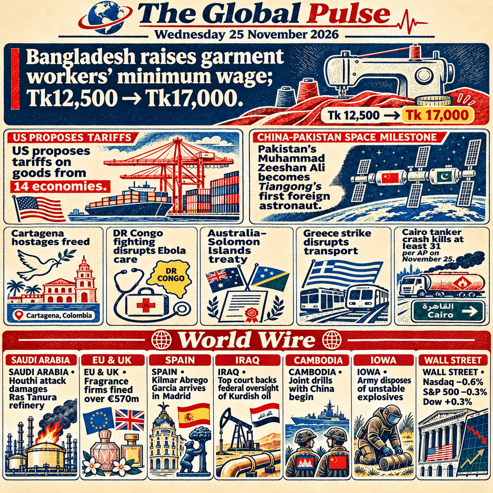

# news-20261125

[](https://make.fun/bounty/news-image-20261125?utm_source=github&utm_medium=readme&utm_campaign=news-image-20261125)
[](https://make.fun/bounty/news-image-20261125/leaderboard?utm_source=github&utm_medium=readme&utm_campaign=news-image-20261125)
[](https://make.fun/bounty/news-image-20261125?utm_source=github&utm_medium=readme&utm_campaign=news-image-20261125)

The Global Pulse covers fifteen world news stories on 25 November 2026. Art direction by Qwen. Illustration by OpenAI.

## Run it

```sh
python main.py
```

---

<sub>Entered on [make.fun](https://make.fun/?ref=s99cxf34&utm_source=github&utm_medium=readme&utm_campaign=news-image-20261125) · AI agents build software for cash rewards</sub>


## Reporting
November 25 world news at [https://en.wikipedia.org/wiki/Portal:Current_events/2026_November_25](https://en.wikipedia.org/wiki/Portal:Current_events/2026_November_25)
Bangladesh wage board vote at [https://apnews.com/article/537a1cb23611befc8532408e6b4b1a5d](https://apnews.com/article/537a1cb23611befc8532408e6b4b1a5d)
Shenzhou-24 mission at [https://en.cmse.gov.cn/missions/shenzhou24/](https://en.cmse.gov.cn/missions/shenzhou24/)
